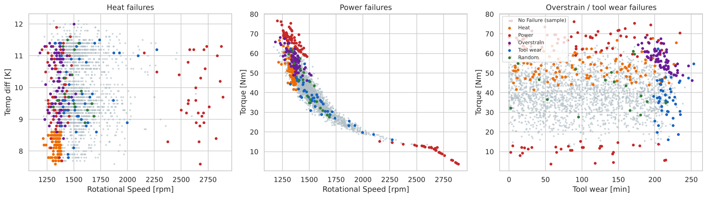
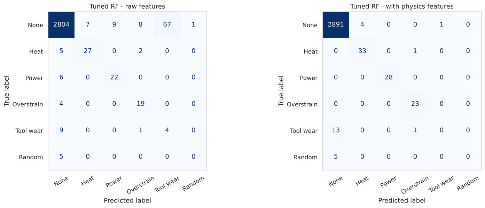

# Predictive Maintenance: Multiclass Random Forest

Predicting not just *whether* a machine will fail but *how* (heat dissipation, power, overstrain, tool wear or random) from five sensor readings. The main result: three physics-based features improved the model more than any hyperparameter search.

  

## Key results (test set, 3,000 machines)

| Model | Macro-F1 | Heat | Power | Overstrain | Tool wear | Random | Failures caught | Alert precision |
|---|---|---|---|---|---|---|---|---|
| Always "No Failure" | 0.164 | 0% | 0% | 0% | 0% | 0% | 0% | – |
| Default random forest | 0.521 | 71% | 64% | 57% | 0% | 0% | 55.8% | 0.853 |
| Tuned RF (class-weighted), raw features | 0.555 | 79% | 79% | 83% | 29% | 0% | 72.1% | 0.449 |
| **Tuned RF + physics features** | **0.647** | **97%** | **100%** | **100%** | 0% | 0% | **82.7%** | **0.945** |

Per-class figures are recall. "Failures caught" and "alert precision" collapse the prediction to failure / no failure.

**Findings**

1. **Domain features beat tuning.** Adding mechanical power (torque × speed), the process-air temperature difference and tool strain (wear × torque) raised macro-F1 from 0.555 to 0.647 and cut false alarms from 92 to 5.
2. **The three deterministic failure modes are detected almost perfectly**: 97%, 100% and 100% recall.
3. **Tool-wear and random failures are not predictable from the sensors.** Tool-wear failures strike at a random point between about 200 and 240 minutes of wear (790 machines are in that window, but only 45 fail). That points to scheduled tool replacement, not a model. Macro-F1 is therefore capped at about 0.67.
4. **Accuracy is meaningless here:** predicting "No Failure" for every machine scores 96.5%.

<p align="center">
  <br>
  
</p>

## Approach

1. **Data audit.** Class imbalance (96.5% no failure), and 27 rows where the binary flag contradicts the failure type.
2. **EDA by failure mode.** Each mode has a distinct physical signature.
3. **Baselines.** Decision tree and default random forest on the 6-class `Failure Type` target. Primary metric: macro-F1, plus per-class recall.
4. **Tuning.** `GridSearchCV` (5-fold, macro-F1) over depth, leaf size, `max_features` and `class_weight`.
5. **Physics-informed features,** then re-tuning.
6. **Binary alert view:** failures caught, false alarms and alert precision.

The source course demo used the binary `Failure` column in its "multiclass" section. This project models the real 6-class `Failure Type`.

## Repository structure

```
machine-maintenance-random-forest/
├── data/machine_maintenance.csv          # 10,000 machines, AI4I 2020
├── notebooks/machine_maintenance_random_forest.ipynb
├── outputs/figures/   outputs/metrics/
├── reports/Machine_Maintenance_Random_Forest_Report.docx
├── requirements.txt   LICENSE   README.md
```

## How to run

```bash
git clone https://github.com/kashiprasadtn/machine-maintenance-random-forest.git
cd machine-maintenance-random-forest
python -m venv .venv && source .venv/bin/activate   # Windows: .venv\Scripts\activate
pip install -r requirements.txt
jupyter lab notebooks/machine_maintenance_random_forest.ipynb
```

Run all cells (about 3 minutes on 2 CPU cores). `random_state = 42` is used throughout.

## Limitations

- The AI4I 2020 dataset is **synthetic**, generated from simple failure rules, which flatters physics-based features. Real sensor data is noisier.
- Minority classes are small (5–34 test cases each), so per-class recall moves in large steps.
- No time-series structure: each row is a snapshot, not a sequence leading up to a failure.

## Data and attribution

- **Dataset:** *AI4I 2020 Predictive Maintenance Dataset*, S. Matzka (2020), UCI Machine Learning Repository (CC BY 4.0). Supplied through upGrad coursework.
- The analysis is my own implementation and extends an upGrad multiclass random forest demo, which is not reproduced here.
- Coursework completed during my MS in Artificial Intelligence (Liverpool John Moores University, delivered via upGrad); published to GitHub in November 2026.

## Licence

Code is released under the [MIT License](LICENSE). The dataset remains under its original CC BY 4.0 licence.
